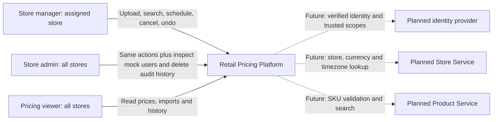

# Context Diagram

## Purpose and boundary

The Retail Pricing Platform lets authorized retail staff upload one store's CSV pricing feed, inspect import outcomes, search scheduled/historical price records, edit or cancel future prices, and create compensating changes. The platform owns pricing data and import/audit records. Store, Product and Auth are currently in-process mock adapters; they are not separately deployed services or databases.

Solid relationships are implemented; dotted external integrations are future replacements. Mock user selection is a development mechanism, not authentication. The platform boundary includes the UI, API, import workers, PostgreSQL persistence and optional Redis. Infrastructure details belong in the solution diagram.

## Actors and permissions

| Actor | Access |
|---|---|
| STORE_MANAGER | View and mutate prices/imports for assigned stores only |
| STORE_ADMIN | Cross-store pricing operations; list mock users; delete a record's audit history with a deletion record |
| PRICING_VIEWER | Cross-store read access; write APIs reject requests |

Backend role middleware and service-level store checks enforce permissions. User creation/editing is not implemented. Country permissions are represented through store membership, not a separate country policy engine.

Evidence: [auth model](../apps/pricing-service/src/auth.ts), [routes](../apps/pricing-service/src/routes/index.ts), [store/product mocks](../apps/pricing-service/src/catalog.ts), [requirements](../requirement.md), [clarifications](../gap-analysis.md).
