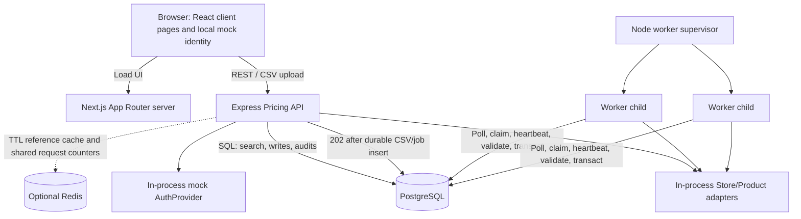
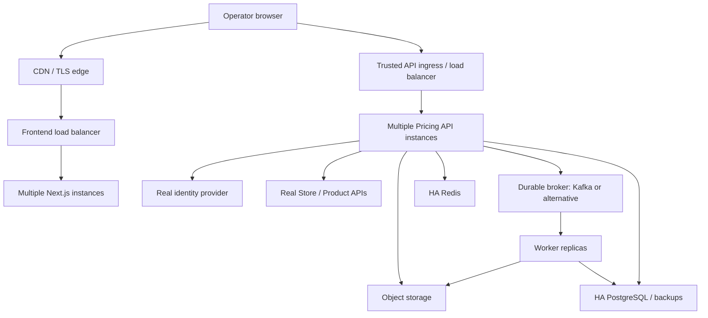

# Solution Architecture

## Current implementation

PostgreSQL is one database with tables for pricing records, jobs, raw CSV payloads, per-row outcomes, audit events and history deletions. The drawing does not imply separate database servers for the queue and pricing data. Next.js predominantly serves a client-driven UI: pricing requests go directly from the browser to Express. API URLs are browser-visible configuration.

## Flows

1. **Identity:** Axios sends a selected mock identity. AuthProvider resolves the server-side mock record; middleware checks roles and services verify store access. Production API startup refuses mock auth unless explicitly overridden for an isolated demonstration.
2. **Search:** the API validates pagination/filter values, adds store scope, runs parameterized COUNT and paginated SELECT queries, and returns decimal strings and pagination metadata. Sort columns are allowlisted. Cross-currency price filters require a currency where applicable.
3. **Edit/cancel:** resolve the immutable store/SKU identity; acquire its PostgreSQL advisory transaction lock; lock/re-read the price; validate scope, date and edit version; mutate and repair interval ends in one transaction. PostgreSQL DATE values are projected as text. Related interval changes receive versions, timestamps and audit records.
4. **Import:** authorize one selected store, enforce a configurable 5 MB file limit, capture the default effective date using that store's timezone, persist CSV and job, then return 202. Child workers claim jobs with SKIP LOCKED and a global concurrency cap. Each claim increments attempts, which fences stale workers. Per-row pricing/outcome writes lock and verify the job generation before taking the SKU timeline lock. Valid rows commit separately; validation failures and duplicate skips remain visible.
5. **Recovery:** workers heartbeat the matching claim generation. Expired work is reclaimable; three attempts is the automatic limit, including repeated crashes. Committed row outcomes prevent replay. Deterministic parser/header errors produce terminal file failures. Infrastructure failures retry the job with committed rows preserved. Retry API requires a finished job and creates a child job containing only failed row numbers, preserving the original default date.
6. **Audit:** manual edits, imports, cancellation, compensation and interval-end repairs are transactional. Admin history deletion creates a separate deletion record. Audit history is application-managed, not tamper-proof storage.
7. **Cache:** Redis caches store lists and product searches with short TTLs; failures fall back to mocks. Limiter errors fail open; no Redis URL means process-local counters. Redis automatically reconnects with bounded delay.

## Statelessness and resource limits

There are no server sessions or durable local upload directories. UI state lives in the browser; PostgreSQL holds durable work. Multiple API or Next.js instances do not require sticky sessions. In-process upload buffers and parsed CSV arrays are temporary but increase peak memory. CSV parsing is synchronous and bounded by file size; this is not streaming. Worker batches bound scheduling/progress updates, while SQL writes remain per row and per-job ownership locks serialize writes within a job.

Default child count is 2, each with a pool of 2 connections. API default pool is 10. A maximum of 10 active jobs is enforced across consumers. Plan the aggregate connection budget before adding replicas. Exact counts, OFFSET pagination, full outcome polling/report buffering and retained raw payloads need capacity testing.

## Target deployment — recommendations, not implemented infrastructure

Kafka/object storage replacement requires new payload-storage and lifecycle adapters; enqueue/claim is only part of the current boundary. An outbox or equivalent delivery strategy is required if job persistence and broker publication become separate operations. No broker, object store, application Dockerfiles, ingress, autoscaler, managed HA, backup job or monitoring stack is shipped.

Evidence: [server](../apps/pricing-service/src/server.ts), [queue](../apps/pricing-service/src/import-queue.ts), [processor](../apps/pricing-service/src/import-processor.ts), [worker](../apps/pricing-service/src/worker-process.ts), [schema](../apps/pricing-service/database/migrations/001_initial.sql), [timeline service](../apps/pricing-service/src/services/price-timeline-service.ts), [Compose](../compose.yaml).
